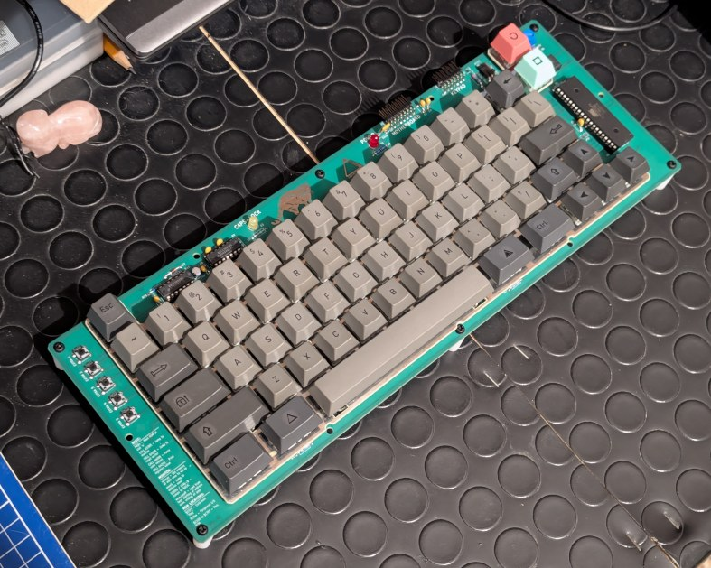

# DELTA Redux Keyboard

## DISCLAIMER

Any use of this project is **under your own responsibility**.
By using this project You will agree that I cannot be held responsible if it will destroy any of your devices, damage your computer, burn down your house or whatever.

### Sponsorship

This project is sponsored by [PCBWay](https://pcbway.com).
PCBWay specializes in manufacturing high-quality PCBs and makes them affordable to hobbyist and professionals alike.

The range of services they offer include PCB prototyping, assembly, instant quotes for your order, a verification process by a team
of experts and an easy to use, hassle-free order process.

Thanks to PCBWay, I was able to bring this project to production and to release it for everyone to use much earlier than it would have been possible otherwise.

## Introduction

This projects aims to create an ASCII keyboard tailored for use on to the [DELTA](https://codeberg.org/hkzlab/NE_Delta_Schematics) computer.
The work is based off the [Replica Datanetics Keyboard](https://github.com/schlae/replica-datanetics) by [Tube Time](https://mastodon.social/@tubetime), but sporting a different PCB, a modified circuit and firmware.

This keyboard supports uppercase and lowercase characters, both the strobe and AKD signals and caps-lock functionality (without using a mechanical latch), and can be built with your Cherry MX compatible switches of choice!

### Features

- Supports upper and lowercase characters
- Reset can be performed either with the reset button alone, or with the CTRL-Reset combination, depending on a jumper
- Caps lock without a mechanical latch
- Repeat key with adjustable frequency
- AKD signal
- External numeric keypad support
- 5 "extra" keys that can send custom strings to the attached machines

#### The "extra" keys

The "extra" keys are keys that simply trigger an automatic transmission of a string to the host computer, a macro. The strings are baked into the MCU, and the [firmware](fw/main.c) must be recompiled to change them.

The default strings are:
1. `PR#3\r`: Enables 80 column mode
2. `PR#6\r`: Boots card on slot 6
3. `CATALOG\r`: DOS command to list files on floppy
4. `CALL 65385\r`: When inside the BASIC interpreter, this will switch to the monitor
5. `03F4:00\rFA69G\r`: When inside the monitor, this will force a cold-reset

**Note that the optional numpad is still work-in-progress!**

### Support

If you wish to support me in building new hardware and software for old machines, [throw a few euros in my direction via Ko-Fi](https://ko-fi.com/hkzlab) ☕!

## Build one!

### Order the PCBs

You can find the gerbers in this repository, or you can order the PCBs at **PCBWay!**

You will one of each of the following:

- The [keyboard base](https://www.pcbway.com/project/shareproject/DELTA_Redux_ASCII_keyboard_0ab7f83a.html), where the switch and the circuitry solders to
- The [keyboard plate](https://www.pcbway.com/project/shareproject/DELTA_Keyboard_key_switch_plate_5280364c.html), where the switches are snapped into. Used to keep them stable
- The [IDC to DIP-16 adapter](https://www.pcbway.com/project/shareproject/DELTA_Keyboard_DIP_16_adapter_b9be4866.html). Unless you wish to use a DIP16 adapter directly on your IDC cable.

### Fixes

- [Keyboard](keyboard/fixes.md)

### Bill of Material

Every board directory contains a `bom.md` file containing the bill of material for the card.

Except for the plates: those are just support structure, nothing must be soldered to them.

- [Keyboard](keyboard/bom.md)
- [DIP-16 adapter](dip_adapter/bom.md)

## Thanks

- [TubeTime](https://mastodon.social/@tubetime) for the Datanetics replica I used as a base