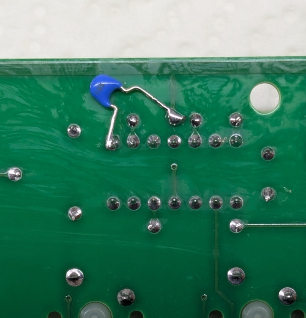
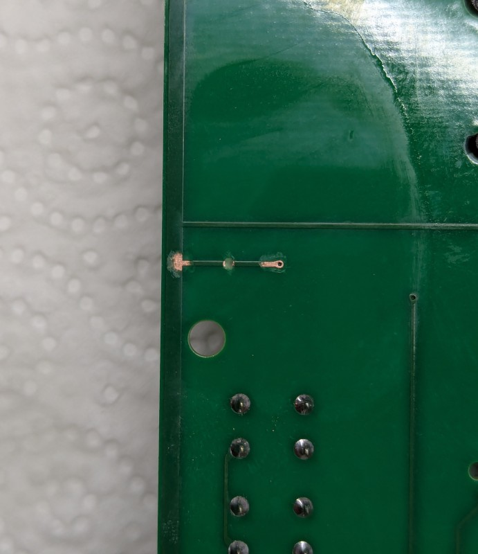
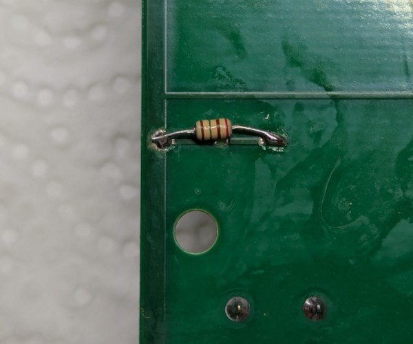
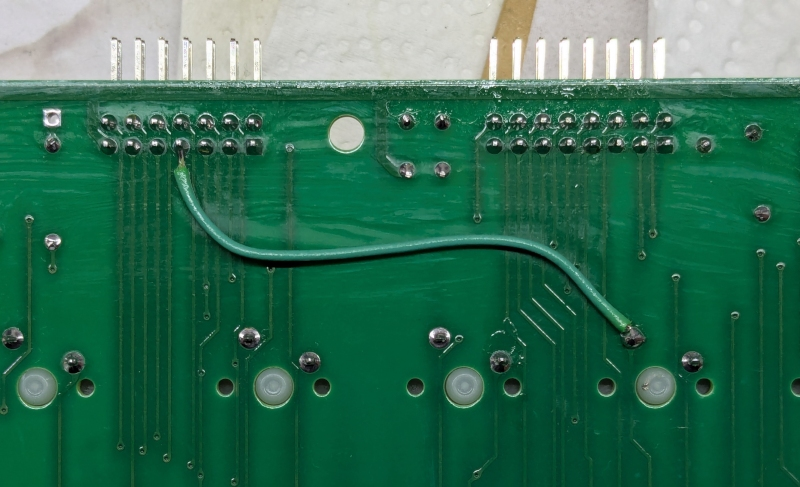

# Keyboard base: Required fixes

## Rev. 0

All of these fixes have been included in Rev.1

### R9 resistor value

Replace R9 resistor with an 1K one (silkscreen says 4.7K)

### Additional capacitor for caps-lock debounce circuit

Bodge a 10uF/25V+ MLCC capacitor between pin 1 of U4 and GND (refer to picture below)

### Current limiting resistor for caps-lock

This may be a bit on the paranoid side, but, to limit current inrush when the caps-lock switch is closed, a small-ish
(150 ohm) reistor must be added in series to the switch.

Cut the trace on the underside of the board, running from pin 1 of SW56 (the caps-lock switch) and GND. Also, scrape
some solder mask on the sides of the cut.

Trim the legs on a small resistor, value around 150 ohm, and solder the resistor on the scraped copper.

### Missing link for Y7 column on numpad connector

Bodge a wire between pin 7 of J3 and pin 1 of SW6 (refer to picture below)

